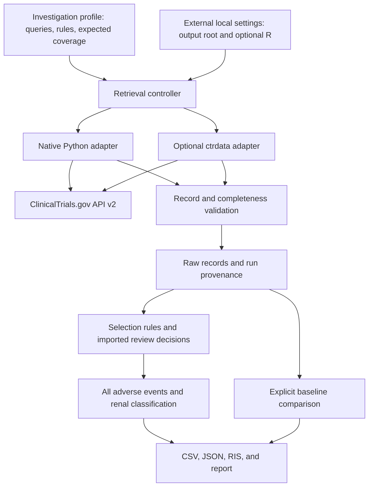

# Architecture

The scientific workflow is independent of the retrieval client. A profile describes the investigation; adapters return full source records; the same selection and extraction code runs on either result.

## Layer boundaries

| Layer | Responsibility | State |
| --- | --- | --- |
| Profiles | Queries, inclusion/exclusion rules, expected aliases and trials | Implemented |
| Retrieval | Pagination, bounded retries, raw artifacts, source-version checks | Implemented |
| Adapter interface | Native and optional R paths return the same record contract | Implemented |
| Run controller | Whole-plan fallback, completion status, provenance, output location | Implemented |
| Selection | Automatic rules and explicit CSV review overrides | Implemented; no interactive review application |
| Evidence | Source-preserving AE rows and a renal classification view | Implemented; classification remains heuristic |
| Comparison | Record differences against a user-selected completed run | Implemented; no automatic baseline selection |
| Delivery | Files and command-line interface | Implemented; no web interface |
| Scheduling and other registries | Recurring execution, CTIS, ISRCTN, or other sources | Future extensions |

## Extending a search

Change or add a profile for a different condition, drug class, or mechanism. Keep topic-specific aliases and exclusions out of the retrieval layer. The renal view remains available even when the underlying investigation is not kidney-specific; the full AE export remains available for other analyses.

A future topic branch can add its profile, expected coverage, and synthetic regression fixtures while continuing to use the same general package. A separate branch is a development choice, not a requirement to run a different profile.

## Extending a backend

Implement the [retrieval contract](adapters.md) and prove that the same query plan produces equivalent registry records. Do not feed a convenience dataframe into the evidence layer: dropping fields, coercing missing counts to zero, or joining arms changes the evidence contract.

Supporting another registry requires a new source model and explicit field mapping. The existence of other registry clients in `ctrdata` does not make those registries supported here.

## Failure boundaries

A run is complete only after retrieval and downstream validation succeed. Failed attempts retain diagnostics. A successful fallback cannot silently merge records from a failed native attempt. Empty results are valid retrieval results, although expected-coverage checks may warn about them.

Completeness is scoped to the submitted query and registry response. It does not establish that the search strategy found every relevant trial. Human scope decisions and changes to the profile remain part of the interpretation.
